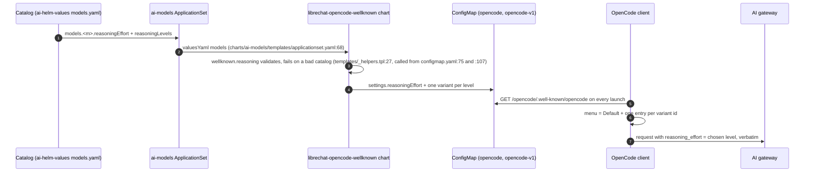
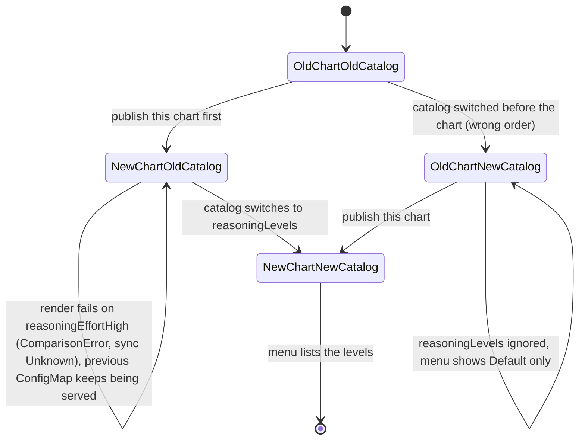

# ADR-0143: One OpenCode variant per catalog reasoning level

**Status:** Accepted
**Date:** 2026-11-14
**Deciders:** @stephane-segning

## Context

ADR-0125 caps reasoning effort per model: the catalog carries `reasoningEffort`
(the default, e.g. `low`) and `reasoningEffortHigh`, and the well-known chart
(`charts/librechat-opencode-wellknown`) renders them as the model's default
`settings.reasoningEffort` plus **one** variant with the fixed id `thinking`.

The OpenCode client's model menu shows a fixed "Default" entry (no variant, so the
default effort) plus one entry per variant, **labelled with the variant id**. Every
model therefore offered exactly "Default" and "thinking". Users want to pick among
several levels, from off to maximum. The host sends a variant's
`settings.reasoningEffort` verbatim as `reasoning_effort` and silently drops
non-string values.

Backends do not share one effort vocabulary, and what a request schema accepts is
not what a model honours. DeepInfra's request schema (public OpenAPI,
`OpenAIChatCompletionsIn.reasoning_effort`, read 2026-11-14) accepts
`none | minimal | low | medium | high | xhigh | max` and says `none` disables
reasoning "if the model supports". Google's OpenAI-compatible API (read 2026-11-14)
accepts `minimal | low | medium | high` and cannot turn reasoning off on Gemini 3
models. Some models reject `reasoning_effort` altogether and are deliberately
uncapped. When this was decided only `low` and `high` had been exercised in
production; every other level in a catalog list is unprobed until someone runs
ai-helm-values `tools/probe-reasoning-levels.sh` against it.

A second problem sits underneath: `values.yaml` is parsed as YAML 1.1 by Helm, so an
unquoted `reasoningEffort: off` is the boolean `false`, and the old template's
truthiness check silently dropped the cap with no error.

## Decision

Replace `reasoningEffortHigh` with a per-model list, hard cutover, no flag and no
back-compat path:

```yaml
reasoningEffort: low                      # unchanged: the default ("Default" in the menu)
reasoningLevels: [none, low, high, max]   # NEW: selectable levels, in menu order
```

For each `reasoningLevels` entry the chart emits one variant whose **id is the level
string and whose effort is the level string**: a list in the v2 `opencode` document,
a map in the temporary v1 `opencode-v1` document (ADR-0142). Catalog order is kept,
and nothing is de-duplicated against the default: the author lists exactly what the
menu shows. A model with only `reasoningEffort` gets only the default; a model with
neither key stays absent from `models` (uncapped).

One named template, `wellknown.reasoning` (`templates/_helpers.tpl`), validates the
catalog and both documents consume its output. The validation is shared; the two
rendering loops in `configmap.yaml` (v2 list, v1 map) are separate code, kept in
step by `tests/opencode-wellknown-reasoning/run.sh`. The render **fails**, naming
the model and the key, on:

1. `reasoningEffortHigh` present (any value): the key was replaced, the catalog is stale.
2. `reasoningLevels` without `reasoningEffort`.
3. `reasoningEffort` null, or not a non-empty string (YAML 1.1 `off`/`no`/`on`/`yes` booleans, bare numbers).
4. `reasoningLevels` not a list, or an empty list (to offer no extra levels, omit the key).
5. A `reasoningLevels` entry that is null or not a non-empty string (quote it: `"off"`).
6. A duplicate `reasoningLevels` entry (each level is one menu entry). Duplicates compare case-insensitively (`High` and `high` are one level to a human and almost certainly to a backend); the emitted value is never lowercased.
7. An effort or level that is empty or has leading/trailing whitespace (the host sends it verbatim).

All problems across all models are collected and the render fails **once**, with a
count header and one line per problem (each starting `models.<name>:`), sorted by
model name. ArgoCD surfaces only that one message, so reporting just the first bad
model would turn a 28-model stale catalog into 28 sync round trips.

A null or non-map model entry is skipped as "no reasoning keys".





## Consequences

**Positive**
- Users choose the level they want per model; the menu shows exactly the catalog's list.
- The catalog author owns each model's level list, so a level such as `max` or `none` is offered only on the models chosen for it.
- A mistyped or stale catalog fails loudly at render instead of silently losing a cap.
- v1 bridge and v2 cannot disagree: one validated structure feeds both.

**Negative**
- The `thinking` variant id disappears. The OpenCode TUI falls back to Default for a stored selection of a removed variant, but a config or command that pins `<model>#thinking` gets a `VariantUnavailableError`.
- Rollout order matters. This chart must be published **before** the catalog switches keys. Between the two merges ArgoCD cannot generate the well-known Application's manifests: it shows a `ComparisonError` condition with sync status `Unknown`, while health comes from the live resources and stays Healthy. The previously synced ConfigMap keeps being served, so nothing breaks for users, but the Application cannot sync until the catalog lands. The reverse order (catalog first) leaves the old chart ignoring `reasoningLevels` and rendering no thinking variant at all for that window.
- A level a backend rejects only affects a user who selects it; Default is never affected. Nothing in the chart can check a level against a backend, so the catalog author must.
- Helm's `toJson` sorts map keys by byte order, so the v1 variants are sorted by key, not catalog order (v2 keeps catalog order). Acceptable for a bridge that sunsets 2026-12-09.
- This repo's CI cannot render the chart against the REAL catalog, which lives in ai-helm-values. The companion ai-helm-values change adds that check (`tools/check-opencode-wellknown.sh`, run by its `render-check.yml`, asserting both documents against the catalog); until it merges, a stale or mistyped catalog is caught at ArgoCD sync, not in a PR check. That check is red whenever chart and catalog disagree, which includes the window between the two merges.

**Neutral / follow-ups**
- Tested by `tests/opencode-wellknown-reasoning/run.sh` (CI: `opencode-wellknown-reasoning.yml`) and the `ci/reasoning-values.yaml` fixture rendered by `helm-lint.yaml`.

## Alternatives considered

- **A fixed global level list for every model** — rejected: backends accept different vocabularies (Gemini 3 has no `none`), and several models reject `reasoning_effort` entirely. A global list would offer levels that error.
- **Keep `thinking` and add more ids** — rejected: two naming schemes in one menu, and `thinking` says nothing about how much. Id = level is self-describing since hosts label by id.
- **Silently ignore the stale `reasoningEffortHigh` key** — rejected: the cap or levels would vanish with no signal, the same failure mode as the YAML 1.1 `off` boolean. A failed sync serving the previous ConfigMap is the safer failure.

## Related

- Amends: [ADR-0125](./0125-unified-model-visibility-at-gateway.md) (only the single `thinking` variant of its cap policy; the default cap stands). Builds on [ADR-0141](./0141-opencode-v2-cutover-of-the-wellknown.md) and [ADR-0142](./0142-temporary-opencode-v1-bridge-descriptor.md).
- Docs: `docs/integrations/opencode-well-known.md` ("Reasoning levels")
- Charts/files touched: `charts/librechat-opencode-wellknown/templates/{configmap.yaml,_helpers.tpl}`, `charts/librechat-opencode-wellknown/ci/reasoning-values.yaml`, `charts/ai-models/ci/lint-values.yaml`
